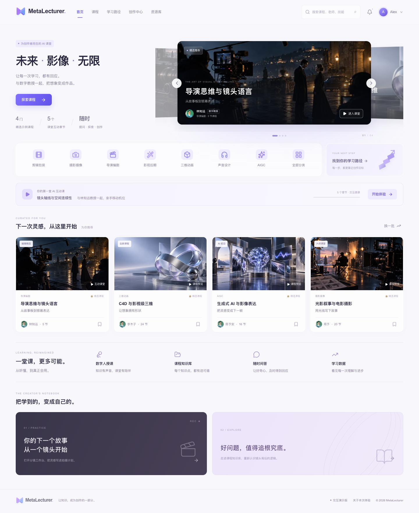
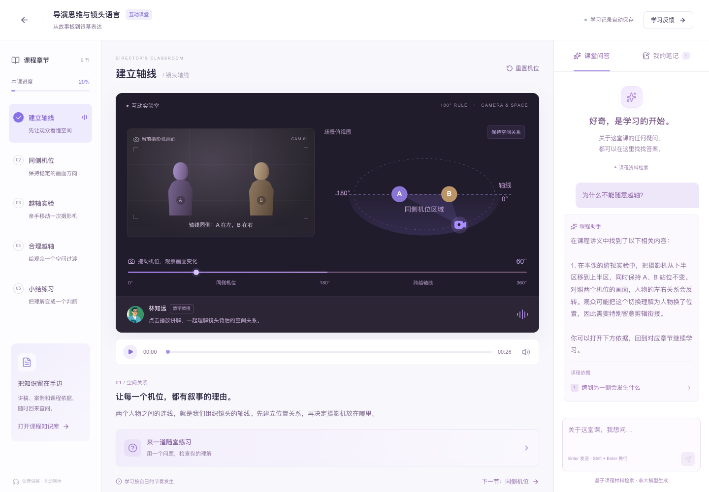

# MetaLecturer

[English](README.md) | [简体中文](README.zh-CN.md)

An interactive AI-powered classroom demo built with Next.js, React, and TypeScript for educational product scenarios.

Designed around an end-to-end interactive flow—**Course Discovery → Interactive Learning → Grounded Q&A → Learning Analytics**—this project serves as a playable product prototype and AI Product Manager portfolio showcase.

[Live Demo](https://metalecturer-demo.vercel.app) · [GitHub Repository](https://github.com/realruian/metalecturer-demo) · [Issue Tracker](https://github.com/realruian/metalecturer-demo/issues) · [MIT License](LICENSE)

> This is a self-contained product demonstration. No login or LLM API key is required. Classroom Q&A is powered by deterministic retrieval over curated course materials rather than a live large language model.

## Screenshots

### Course Home



### Interactive Classroom



## Key Features

| Module | Capabilities |
| --- | --- |
| Course Discovery | Featured course carousel, category filtering, search, course details, and bookmarks |
| Interactive Classroom | Pre-generated Chinese voice narration, 5 course chapters, playback controls, interactive camera-placement lab, and in-class quizzes |
| Grounded Course Q&A | Retrieves curated course materials, displays supporting evidence, and jumps to cited chapters on click |
| Course Knowledge Base | Search lecture notes and knowledge snippets, inspect source details, and download Markdown handouts |
| Learning Analytics | Tracks lecture progress, questions asked, quizzes completed, and notes taken, with CSV / JSON export |
| Learning Path | Visualizes step-by-step completion progress based on your actual session activity |
| Storyboard Studio | Edit and reorder shots, save local drafts, and export Markdown storyboard scripts |
| Companion Pages | Sample industry news, creator community showcase, and course cart demo |

## Quick Walkthrough

Open the [Live Demo](https://metalecturer-demo.vercel.app) and follow these steps:

1. On the home page, click **Preview ("试看")** on the featured course *"Director's Mindset & Camera Language" (导演思维与镜头语言)* to enter the classroom.
2. Play the narration, switch chapters, and drag the camera position in the interactive lab to observe how crossing the 180-degree axis affects shot continuity.
3. Ask *"Why shouldn't you cross the axis arbitrarily?" (为什么不能随意越轴？)* in the Q&A panel to inspect the answer and its cited course evidence.
4. Click a citation chip to jump back to the corresponding chapter, or open the Knowledge Base to browse full lecture handouts.
5. Complete the in-class quiz, save a note, and visit Learning Analytics and Learning Path to review your session metrics.

The full walkthrough takes about 3 minutes. You can also visit the **Creator Studio ("创作中心")** to edit and export a storyboard script.

## Tech Stack

- **Framework**: Next.js 16, React 19
- **Language**: TypeScript
- **Styling**: Tailwind CSS 4, scoped page CSS
- **UI Primitives**: Radix UI, custom Button / Dialog components
- **Icons**: Lucide
- **Server API**: Next.js Route Handlers
- **Client Persistence**: Browser `localStorage`
- **Deployment**: Vercel

See `package-lock.json` for exact dependency versions.

## Running Locally

### Prerequisites

- Node.js 22
- npm
- Git

No database, LLM API key, or paid external service is required, and no environment variables need to be configured.

### Install & Start

```bash
git clone https://github.com/realruian/metalecturer-demo.git
cd metalecturer-demo

npm ci
npm run dev
```

Open in your browser:

```text
http://localhost:3000
```

Classroom narration audio starts when you click the play button.

### Verification & Production Build

```bash
# TypeScript type checking
npm run typecheck

# Course retrieval, input validation, and citation tests
npm test

# Production build
npm run build

# Start production server
npm start
```

## Project Structure

```text
app/
  page.tsx              Application entry point
  globals.css           Global styles
  api/chat/route.ts     Course material retrieval API endpoint
components/
  platform.tsx          App shell, navigation, and course catalog
  home.tsx              Course home page
  classroom.tsx         Interactive classroom
  knowledge.tsx         Course knowledge base
  analytics.tsx         Learning analytics & feedback
  learning-path.tsx     Learning path tracker
  studio.tsx            Storyboard studio
  discovery.tsx         Industry news & creator community
  reference-art.tsx     SVG icons and decorative illustrations
  ui/                   Shared UI primitives
lib/
  courses.ts            Sample course catalog data
  knowledge.ts          Lecture handouts, retrieval logic, and input validation
  learning.ts           Client-side learning activity state management
public/
  assets/               Images and course covers
  media/                Pre-generated narration audio files
tests/
  knowledge.test.ts     Retrieval and API route tests
```

## Deployment

This GitHub repository is connected to Vercel with `main` as the production branch.

Pushing commits to `main` triggers an automatic Vercel build and updates the [production site](https://metalecturer-demo.vercel.app) once the build succeeds.

Deployment settings:

| Setting | Value |
| --- | --- |
| Root Directory | Repository root |
| Framework Preset | Next.js |
| Install Command | `npm ci` |
| Build Command | `npm run build` |
| Output Directory | Next.js default |
| Environment Variables | None required |

`vercel.json` specifies the Next.js framework preset. Because the project includes a server-side Q&A Route Handler (`app/api/chat/route.ts`), deployment targets must support Next.js server routes rather than static-only export.

## Scope & Limitations

- **Course Q&A**: Uses keyword and synonym matching over curated lecture notes to return grounded snippets and chapter citations; does not use live LLM generation or vector embeddings.
- **Digital Instructor**: Uses an illustrated instructor persona paired with pre-generated Chinese voice narration; does not include real-time avatar video rendering or lip-sync.
- **Course Content**: Full interactive classroom functionality is focused on one 5-chapter micro-course, while additional courses populate the catalog and detail views.
- **Learning Records**: Persisted in the current browser's `localStorage` without cross-device sync; clearing browser site data resets your progress.
- **Sample Data**: Platform metrics, course pricing, class statistics, news articles, and community posts are illustrative mock data for product demonstration purposes.
- **Course Cart**: Maintains a local selection list without order creation or payment processing.
- **Storyboard Studio**: Supports shot editing, reordering, and Markdown export; does not generate AI images or videos.

## Feedback & Issues

Bug reports and feature suggestions are welcome via [GitHub Issues](https://github.com/realruian/metalecturer-demo/issues).

When reporting an issue, please include:

- The page and steps to reproduce the issue;
- Expected behavior vs. actual behavior;
- Browser, device, and relevant screenshots.

## License & Asset Notice

Original source code and documentation in this repository are released under the [MIT License](LICENSE). For license scope and asset exceptions, see [THIRD_PARTY_NOTICES.md](THIRD_PARTY_NOTICES.md#许可证适用范围).

Images, icons, audio files, and screenshots under `public/assets/`, `public/media/`, and `docs/screenshots/` are excluded from the MIT License; third-party dependencies retain their respective licenses, and product names or branding receive no additional trademark rights from code licensing.

The original HTML prototype is kept only as a local reference and is not distributed with this repository. Some images were extracted from the prototype and have not been independently cleared for redistribution; supplemental covers and fictional instructor avatars were generated with imagegen, and category icons and decorations are implemented in SVG. See `THIRD_PARTY_NOTICES.md` for full attribution details.
